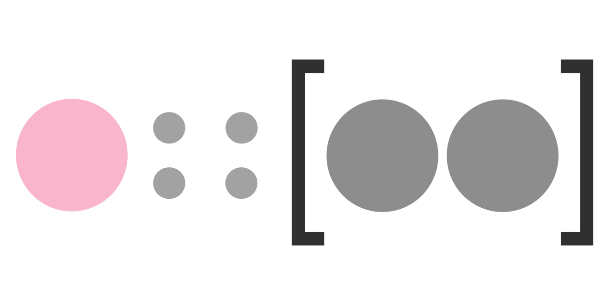

<p align="center">
  
</p>

# Headscale on StartOS

> Everything not listed in this document should behave the same as upstream Headscale. If a feature, setting, or behavior is not mentioned here, the upstream documentation is accurate and fully applicable — see the Documentation section of `instructions.md` for links.

[Headscale](https://github.com/juanfont/headscale) is an open-source implementation of the Tailscale coordination server. This package runs it as a StartOS service so a home server can control its own tailnet with the official Tailscale clients.

---

## Table of Contents

- [Image and Container Runtime](#image-and-container-runtime)
- [Volume and Data Layout](#volume-and-data-layout)
- [File Models](#file-models)
- [Dependencies](#dependencies)
- [Network Access and Interfaces](#network-access-and-interfaces)
- [Installation and First-Run Flow](#installation-and-first-run-flow)
- [Actions](#actions)
- [Tasks](#tasks)
- [Health Checks](#health-checks)
- [Backups and Restore](#backups-and-restore)
- [Limitations and Differences](#limitations-and-differences)
- [Quick Reference for AI Consumers](#quick-reference-for-ai-consumers)

---

## Image and Container Runtime

The package uses the upstream, unmodified container image (`ghcr.io/juanfont/headscale`, both architectures). The image is a scratch/ko build with no shell: its only executable is `/ko-app/headscale`, which serves both the daemon and the admin CLI. No init system is bundled, so the daemon runs the entrypoint directly as `serve`.

One subcontainer, `headscale`, runs everything: the `headscale` daemon, and one-off `headscale` CLI invocations from actions (in short-lived temp containers that share the volume and the daemon's Unix socket).

## Volume and Data Layout

A single volume, `main`, is mounted at `/data` in the subcontainer and holds everything:

| Path                  | Purpose                                             |
| --------------------- | --------------------------------------------------- |
| `/data/config.yaml`   | Generated headscale config (package-owned)          |
| `/data/store.json`    | StartOS-side settings (package-owned)               |
| `/data/db.sqlite`     | Embedded SQLite database (nodes, users, keys)       |
| `/data/derp.yaml`     | Generated DERP map (package-owned): region 999 pointing at the live external ports |
| `/data/headscale.sock`| Unix socket for CLI ↔ daemon communication          |
| `/data/noise_private.key`     | Noise protocol key, generated by headscale on first start |
| `/data/derp_server_private.key` | DERP server key, generated by headscale on first start |
| `/data/tls.crt`, `/data/tls.key` | TLS pair for the passthrough port, minted from the StartOS CA at init |

## File Models

`store.json` (zod-typed, on the main volume) holds the user's choices: the selected server address (`endpointUrl`) and the MagicDNS base domain (`baseDomain`, nullable until **Set Up MagicDNS** has run). It is seeded with empty/null defaults at install and written only by the configuration actions. Hand edits do not survive actions that rewrite the keys, and an invalid value falls back to its default.

`config.yaml` is **generated, never hand-edited**: the package renders it from `store.json` plus the current interface addresses on every start. Manual edits are silently overwritten on the next start — change the settings through the actions. Notable fixed values: SQLite as the database, embedded DERP relay enabled with its own region, upstream update check disabled, metrics bound to loopback only, and the CLI socket at `/data/headscale.sock`.

`derp.yaml` is likewise **generated**: `main.ts` renders region 999 from the live StartOS-assigned external ports (the TLS port of the Coordination API binding, the plain port of the DERP Relay binding) and points `derp.paths` at it, with `automatically_add_embedded_derp_region: false` and `derp.urls: []` — the tailnet's map contains only your own relay, no Tailscale public regions. The indirection exists because the advertised ports are not the container's fixed ports: if another package holds a preferred port (e.g. coturn on UDP 3478), StartOS assigns ours a different external number, and the embedded region's `STUNPort` (taken from `stun_listen_addr`) would otherwise point clients at the wrong port.

## Dependencies

None. Headscale is self-contained: the database is embedded SQLite.

## Network Access and Interfaces

| Interface     | id         | type | port | purpose |
| ------------- | ---------- | ---- | ---- | ------- |
| Coordination API | `control` | api  | 8080 | HTTP control protocol (Tailscale clients register and long-poll here), the v1/v2 HTTP API, and the interactive-login pages. Bound as a TLS passthrough port: StartOS forwards the raw TLS stream and headscale terminates TLS itself with a certificate minted from the StartOS CA (`startos/init/setupCerts.ts`), so HTTP `CONNECT` tunnels — which the reverse proxy rejects — reach the daemon. |
| DERP Relay | `derp` | p2p  | 3478 | STUN (UDP) for the embedded DERP relay, so devices behind NAT can discover their public endpoints through your own box. |

The embedded DERP relay (region 999) is served from the coordination port and advertised in every client's netmap; relayed traffic never leaves your network unless a client also needs the public fallback regions that headscale keeps in its map. Metrics (9090) and gRPC (50443) are bound to loopback inside the container and are deliberately not exposed.

`server_url` — the address advertised to clients — is the `endpointUrl` the user selected in **Configure Headscale**. If the user later disables that address, the critical setup task reappears until they pick an enabled one.

## Installation and First-Run Flow

Install creates `store.json` with empty settings and raises a **critical task**: the service refuses to start until **Configure Headscale** has been run once and a server address chosen (Headscale is useless without a reachable `server_url`). **Set Up MagicDNS** is prompted by a second, non-blocking task; the service runs fine with MagicDNS off. There are no credentials: headscale trusts the network boundary, and all admin happens through StartOS actions (which exec the bundled CLI over the Unix socket) or the local API.

Devices join with keys, never passwords: **Add Device** mints a pre-auth key; the user runs the returned `tailscale up --login-server=... --auth-key=...` command on the device.

## Actions

- **Configure Headscale** (`configure`) — choose the server address. Rewrites `store.json`; the service restarts and re-renders `config.yaml`. Safe to repeat; choosing the current value is a no-op-ish restart.
- **Set Up MagicDNS** (`setup-dns`) — set or change the base domain. Restarts the service (config re-render). Repeat-safe.
- **Add Device** (`add-device`) — ensures the single headscale user exists (creates it lazily on first use), then mints a pre-auth key with the chosen expiration/reusable/ephemeral settings. Returns the key (masked) and the full connect command (copyable). Requires the service running; repeat-safe (each run creates another key).
- **View Devices** (`view-devices`) — read-only device list with addresses and connected/expired/last-seen state. Requires the service running.
- **Expire Device** (`expire-device`) — logs the selected device out (`nodes expire`); it stays registered and must reauthenticate. Non-destructive; use this to kick a device temporarily.
- **Remove Device** (`remove-device`) — deletes the selected node from the database (`nodes delete --force`; the plain CLI prompts interactively and would silently no-op over a non-TTY exec). Destructive: rejoining requires a fresh key.

## Tasks

- **Configure Headscale** — critical. Raised whenever `store.json` has no server address, or the saved address is no longer an enabled address on the Coordination API interface (the user disabled it in the Interfaces screen). Blocks service start; clears by running **Configure Headscale**. Can return, e.g. after a restore onto a differently named server.
- **Set Up MagicDNS** — important. Raised while `baseDomain` is unset; cleared by running the action. Does not block start.

## Health Checks

The `headscale` daemon's `ready` check execs `headscale health` in the subcontainer, which round-trips the CLI ↔ daemon Unix socket and the server's own health endpoint. It is stricter than a port check: it fails when the process is up but the API is wedged. "Headscale is not ready" alongside a live process usually means a broken config (check the daemon log — headscale fails startup with a fatal config error on invalid combinations, e.g. MagicDNS on with an empty base domain).

A benign transient to expect in the log: deleting or expiring a node whose client still holds an open long-poll logs `failed to disconnect node ... node not found` until that client reauthenticates (upstream-side; fixed on headscale's `main`).

## Backups and Restore

The whole `main` volume is backed up (SQLite copied wholesale — StartOS stops the service for the duration, so the database and its WAL are consistent). A restored instance keeps its users, nodes, keys, noise/DERP keys, and settings. Expect to re-run **Configure Headscale** after restoring to a different server: the saved address (hostname) will no longer match, and the critical task will hold the service until a new one is chosen. Connected devices keep working as long as they can reach the new address.

## Limitations and Differences

1. `config.yaml` is package-generated; upstream's config example and CLI flags for other settings are not exposed. Fixed choices: SQLite, allow-all policy (no policy file), ACME off (the package serves its own StartOS-CA certificate), update check disabled.
2. **The control port is a TLS passthrough, not a proxied one.** The relay needs HTTP `CONNECT` to reach headscale, and the StartOS reverse proxy rejects `CONNECT` (`405`); stock clients never fall back to the WebSocket transport (`TS_DEBUG_DERP_WS_CLIENT=1`), and no map field can force it. So the package binds the coordination port `secure: { ssl: true }` with `addSsl: null` and serves the StartOS-CA certificate itself (`setupCerts`). Consequences: no proxy auth or `X-Forwarded-*` on that port, ACME for custom domains does not apply to it, and the certificate's SAN set must cover every address a client dials — it is reissued reactively from the binding's addresses, and a reissue restarts the daemon (`main.ts` watches the pair). A SAN set that collapses takes the daemon down with it.
3. Interactive (no-key) registration needs OIDC; the package does not configure an OIDC issuer. All devices join via pre-auth keys.
4. Clients reaching `server_url` must trust the StartOS root CA (this is a Tailscale client requirement, not package policy) — on the box's own network this is automatic, LAN devices may need the CA installed.
5. No admin web UI ships: headscale has none built in (upstream documents third-party ones), and the package manages everything through actions and the local socket.
6. ACL/policy editing is not exposed (allow-all). File-mode policies are possible upstream.
7. The CLI socket is at `/data/headscale.sock` (config default `/var/run` is not persisted); all package execs pass `-c /data/config.yaml`.

## Quick Reference for AI Consumers

```yaml
package_id: headscale
image: ghcr.io/juanfont/headscale
architectures: [x86_64, aarch64]
subcontainers: [headscale]
volumes:
  main: /data
file_models:
  - /data/store.json
  - /data/config.yaml
startos_managed_env_vars: []
dependencies: none
interfaces:
  control: { type: api, port: 8080 }
actions:
  - configure
  - setup-dns
  - add-device
  - view-devices
  - expire-device
  - remove-device
tasks:
  - { action: configure, severity: critical }
  - { action: setup-dns, severity: important }
health_checks:
  - headscale
```
